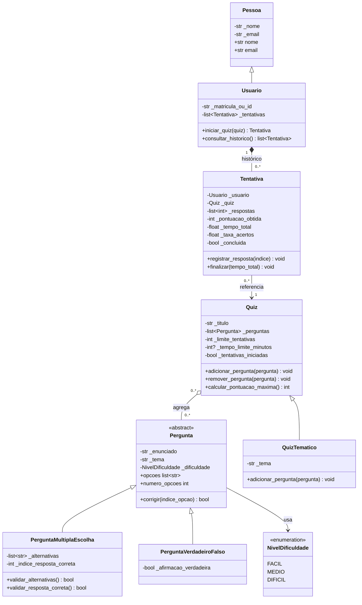

# Modelo de classes

## UML textual

```text
Classe Pessoa
  Atributos: - _nome: str | - _email: str
  Métodos:   + nome: str | + email: str | + __str__(): str

Classe Usuario herda de Pessoa
  Atributos: - _matricula_ou_id: str | - _tentativas: list[Tentativa]
  Métodos:   + iniciar_quiz(quiz): Tentativa
             + consultar_historico(): list[Tentativa]

Classe abstrata Pergunta
  Atributos: - _enunciado: str | - _tema: str | - _dificuldade: NivelDificuldade
  Métodos:   + opcoes: list[str] {abstrato}
             + corrigir(indice_opcao): bool {abstrato}
             + numero_opcoes: int | + __str__() | + __eq__() | + __hash__()

Classe PerguntaMultiplaEscolha herda de Pergunta
  Atributos: - _alternativas: list[str] | - _indice_resposta_correta: int
  Métodos:   + alternativas: list[str] | + validar_alternativas(): bool
             + validar_resposta_correta(): bool | + corrigir(indice): bool

Classe PerguntaVerdadeiroFalso herda de Pergunta
  Atributos: - _afirmacao_verdadeira: bool
  Métodos:   + afirmacao_verdadeira: bool | + opcoes: list[str]
             + corrigir(indice): bool

Classe Quiz
  Atributos: - _titulo: str | - _perguntas: list[Pergunta]
             - _limite_tentativas: int | - _tempo_limite_minutos: int | None
             - _tentativas_iniciadas: bool
  Métodos:   + adicionar_pergunta(pergunta): None
             + remover_pergunta(pergunta): None
             + calcular_pontuacao_maxima(): int | + __len__() | + __iter__()
             - _marcar_tentativa_iniciada() | - _validar_editavel()

Classe QuizTematico herda de Quiz
  Atributos: - _tema: str
  Métodos:   + tema: str | + adicionar_pergunta(pergunta): None

Classe Tentativa
  Atributos: - _usuario: Usuario | - _quiz: Quiz | - _respostas: list[int]
             - _pontuacao_obtida: int | - _tempo_total: float
             - _taxa_acertos: float | - _concluida: bool
  Métodos:   + registrar_resposta(indice): None | + finalizar(tempo_total): None

Enum NivelDificuldade { FACIL, MEDIO, DIFICIL }
```

## Relações

- `Usuario` herda de `Pessoa`.
- `PerguntaMultiplaEscolha` e `PerguntaVerdadeiroFalso` herdam de `Pergunta`.
- `QuizTematico` herda de `Quiz`.
- `Quiz` agrega zero ou mais perguntas; uma pergunta pode ser reutilizada em vários quizzes.
- `Usuario` mantém zero ou mais tentativas; cada tentativa pertence a um usuário.
- Cada `Tentativa` referencia exatamente um quiz.
- Cada `Pergunta` usa um valor de `NivelDificuldade`.

## Diagrama Mermaid



## Fluxo de uma tentativa

1. `Usuario.iniciar_quiz(quiz)` valida o tipo do quiz, a presença de perguntas e o limite daquele usuário para aquele objeto.
2. `Tentativa.registrar_resposta(indice)` verifica que a escolha existe para a pergunta ainda sem resposta.
3. `Tentativa.finalizar(tempo_total)` exige todas as respostas, valida a duração e chama `corrigir()` em cada pergunta.
4. O resultado é guardado na tentativa e permanece no histórico do usuário. Tentativas e relações são serializadas em JSON.

O limite opcional é configurado em minutos; o tempo gasto é gravado em segundos. O primeiro é apenas informativo até existir regra para timeout.
