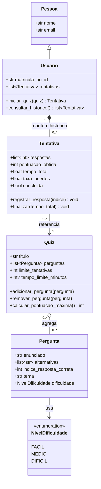

# Modelo das classes

## Herança e relacionamentos

- `Usuario` herda de `Pessoa` os dados e validações de nome e e-mail.
- `Quiz` agrega perguntas. Uma mesma pergunta pode estar em mais de um quiz.
- `Usuario` mantém o histórico de tentativas; cada `Tentativa` referencia o usuário e o quiz correspondente.
- `Pergunta` usa `NivelDificuldade` para restringir os níveis disponíveis.

## Fluxo de uma tentativa

1. O usuário inicia um quiz com `iniciar_quiz(quiz)`.
2. `registrar_resposta(indice)` guarda a opção escolhida para a próxima pergunta.
3. `finalizar(tempo_total)` calcula a pontuação e a taxa de acertos.

## Diagrama

